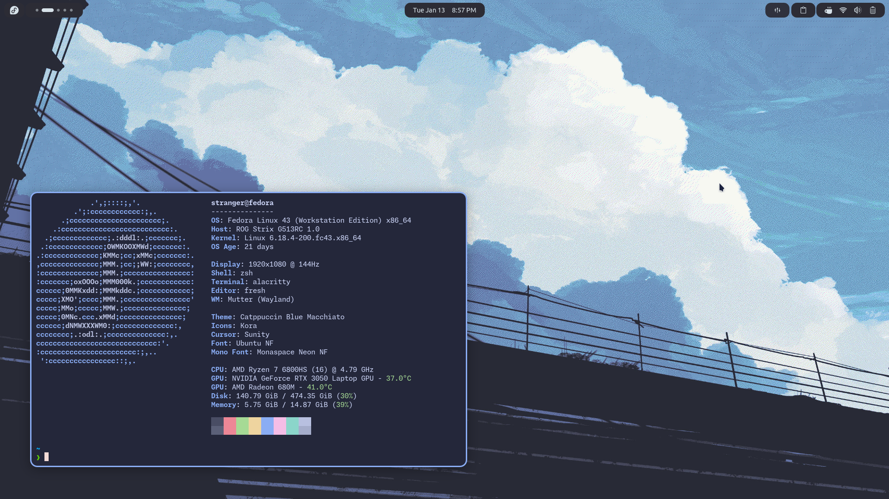
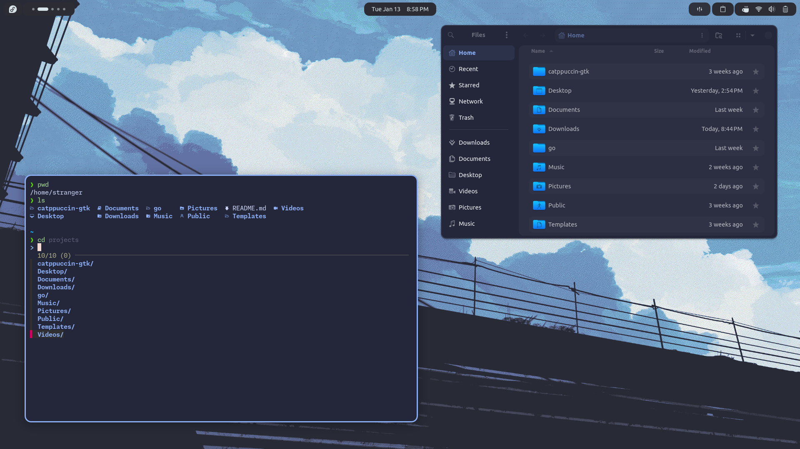
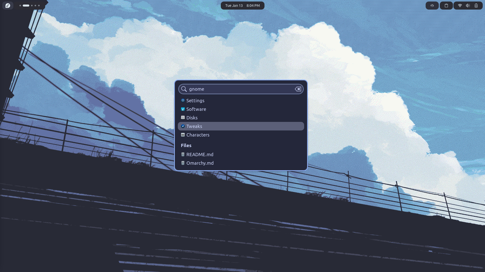
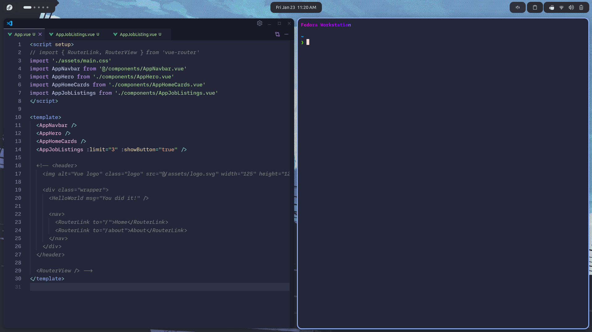
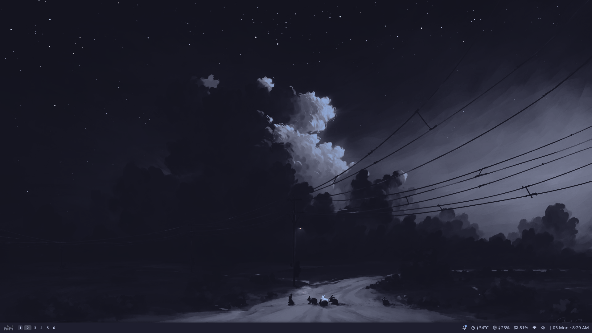
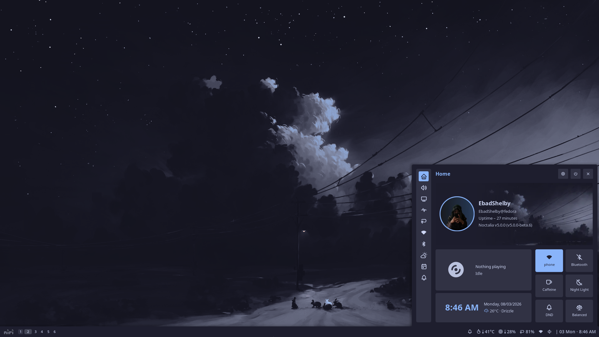
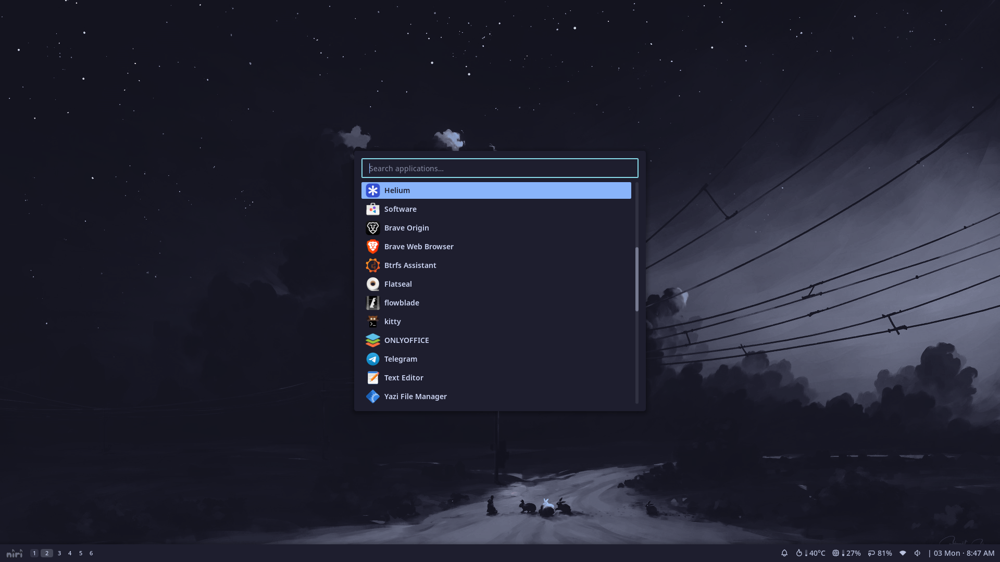
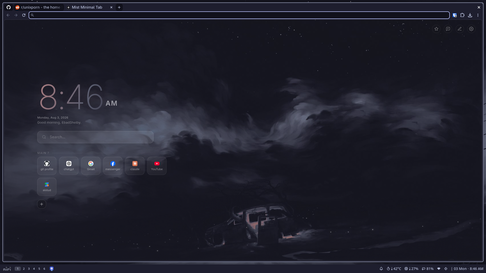
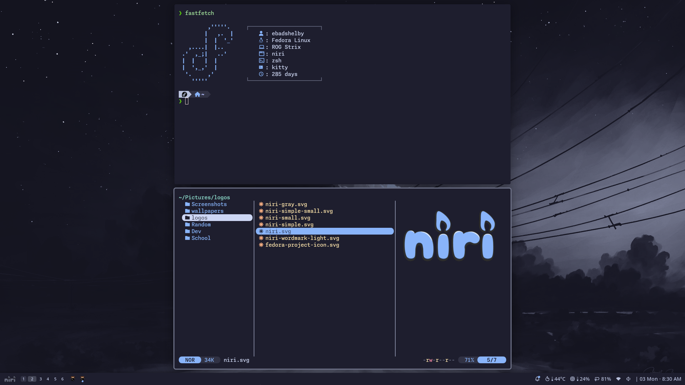

# 🐧 Fedora Workstation

> Optimized for a **majestic, fast, and productive Fedora Workstation with Niri** experience.

---

# 📑 Quick Navigation

- [Desktop Environments](#desktop-environments)
  - [GNOME](#gnome)
  - [Niri (Wayland)](#niri-wayland--noctalia)
- [Desktop Configuration](#desktop-configuration)
  - [Appearance](#appearance)
  - [Extensions (GNOME)](#extensions-gnome)
- [🛠 Terminal & CLI Tools](#-terminal--cli-tools)
- [💻 Applications](#-applications)
- [Star History](#star-history)

---

# Desktop Environments

## GNOME

## Niri (Wayland) + Noctalia

---

# Desktop Configuration

### Appearance

* **Theme:** Catppuccin Mocha
* **Terminal Font:** Monaspace Neon NF

---

### Extensions (GNOME)

* ArcMenu
  * Runner launcher
* Tiling Shell
* AppIndicator and KStatusNotifierItem Support
* Caffeine
* Clipboard Indicator
* Just Perfection
* Open Bar
* User Themes
* Vitals
* Rounded window corners reborn

---

# 🛠 Terminal & CLI Tools

### Shell

* kitty
* **zsh** + **oh-my-zsh**

  * zoxide
  * atuin
  * powerlevel10k
  * zsh-autosuggestions
  * zsh-syntax-highlighting
  * fzf-tab

### CLI Utilities

* **drift**        - Terminal ASCII screensaver (also triggered on desktop idle via `swayidle`)
* **swayidle**     - Idle management daemon for Wayland
* **swaylock**     - Screen locker for Wayland
* **fresh**        - An IDE/text editor in your terminal
* **yazi**         - Blazing fast terminal file manager
* **snapper**      - Btrfs snapshot and rollback manager
* **fast-cli**     - network speed test on your terminal
* **glazepkg**     - view installed tools from different sources in one view
* **harlequin**    - Full-featured SQL IDE in the terminal
* **yoinks**       - CLI video downloader
* **ghgrab**       - terminal tool that lets you browse and download files from GitHub
* **usbtree**      - TUI for inspecting the USB device tree
* **lazygit**      - Terminal UI for Git
* **lazydocker**   - Terminal UI for Docker
* **aria2c**       - Multi-source command-line download utility
* **unar**         - better way to extract files on your terminal
* **tldr**         - Simplified command examples
* **bat**          - Better cat with syntax highlighting
* **fd**           - Fast and user-friendly find alternative
* **fzf**          - Fuzzy finder for files and commands
* **ripgrep**      - Ultra-fast text search tool
* **lsd**          - Modern replacement for ls
* **fastfetch**    - Fast system information display
* **ps_mem**       - better way to show total ram usage of each app
* **system-config-printer** - manage printer. useful for wm like niri

---

# 💻 Applications

## System

* btrfs-assistant
* Extension Manager
* Gnome Tweaks
* Flatseal
* Gearlever
* rog-control-center
* GDM settings
* Gparted
* Mission Center
* Disk Usage Analyzer

## Work

* VSCode
* Antigravity
* Virt-manager
* Obsidian
* GNOME text editor
* ONLYOFFICE

## Media

* GPU Screen Recorder
* ArtCraft Launcher
* Filmcraft
* Pdfcraft
* Photocraft
* SoundCraft
* ShutterEncoder
* VideoTrimmer
* Upscaler
* Gradia
* SimpleScan - docu scanner
* Decibels - audio player
* Papers - docu viewer
* Loupe - image viewer

## Web & Communication

* Brave Origin
* LocalSend
* Bitwarden (browser extension)

---
